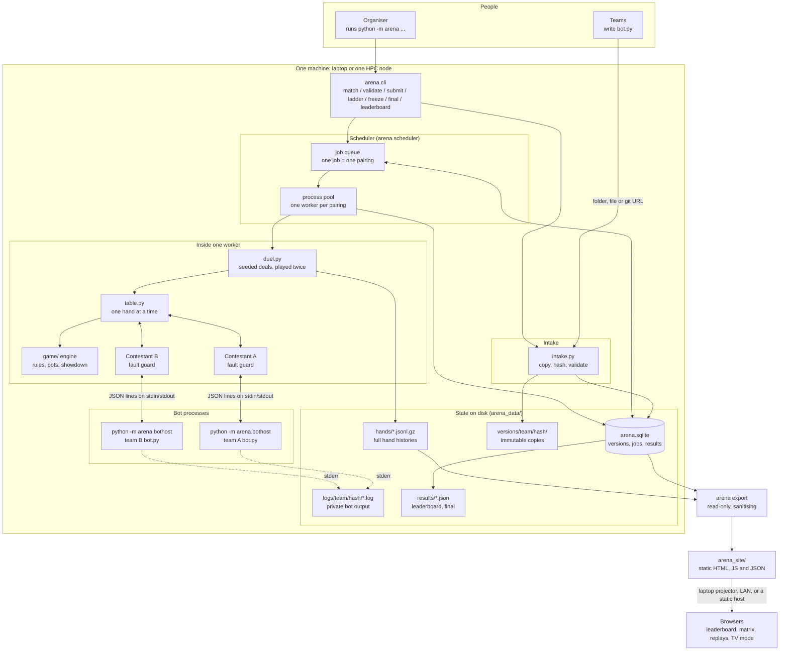
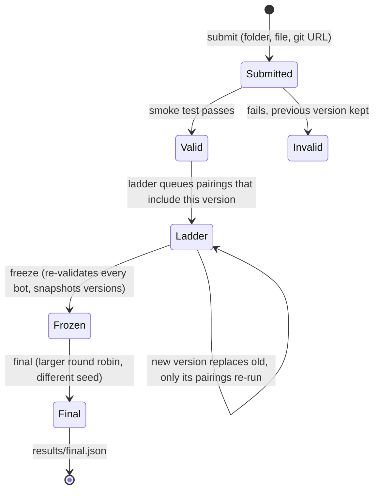

# Competition architecture

This describes how the **bot competition** works: the `arena/` package.
Nothing in it uses HTTP, WebSockets or any network service. Bots are ordinary
child processes on the organiser's machine, and all state is local files plus
one SQLite database.

People see the results through a **static website**: `python -m arena export`
turns the results into a folder of plain HTML, CSS, JavaScript and JSON that
can be shown from the laptop or pushed to any static host (see
[section 9](#9-the-results-website)). It contains no server code and never
accepts uploads.

The older HTTP/WebSocket match server (`server/`, `player_sdk.play()`,
`admin_sdk`) still exists in the repository for live network matches, but the
competition does not use it. See [the last section](#what-the-competition-does-not-use).

Related documents: [README.md](README.md) (quick start),
[DESIGN.md](DESIGN.md) (why this design was chosen),
[AUDIT.md](AUDIT.md) (rules and robustness audit).

## 1. The picture



Network use: `git clone` when a team submits a git URL, and, only if you choose
to, serving or pushing the exported site folder. Bots never touch the network
through the harness.

## 2. Components

| File | Job |
|---|---|
| `arena/bothost.py` | The child process that hosts one bot: imports `bot.py`, then loops reading one JSON line and writing one JSON line. Its `print` output is redirected to stderr, so it can never corrupt the protocol. |
| `arena/agents.py` | `ProcessAgent` (talks to a real child process, kills it on timeout, never raises when closing) and `LocalAgent` (in-process, for the built-in baselines and tests). |
| `arena/contestant.py` | The **fault guard**. Turns an exception, timeout, crash, garbage reply or illegal action into a legal fallback (check if free, else fold) and records a fault. After 20 faults, or after overdrawing the thinking-time bank, replaces the bot with an always-fold stub. |
| `arena/table.py` | Plays one hand: asks the engine whose turn it is, asks that contestant, applies the action, repeats until the hand ends. Asserts chips are conserved. Returns a full hand record. |
| `arena/duel.py` | Plays a **pairing**: N seeded deals, each played twice with the seats swapped, bots restarted between the two halves. Produces mean bb/hand and a 95% confidence interval. |
| `arena/stats.py` | Mean, standard error and Student-t confidence intervals. |
| `arena/baselines.py` | `fold`, `call`, `random`, `shove` (also `@fold` etc.; PowerShell needs `'@call'` quoted, so the bare name is the portable form). |
| `arena/specs.py` | Turns `@name` or a path into a contestant. |
| `arena/validate.py` | The smoke test every submission must pass (a short match against `@call`). |
| `arena/intake.py` | Submission: copy to `versions/<team>/<hash>/`, content-hash, validate, make current only if valid. Git sources are cloned shallowly with prompts disabled, a timeout, and `--` before the address (a source starting with `-` is refused). |
| `arena/sync.py` | Pulls each team's bot from its own repository, from a teams file (`team url [branch]`, https only, strictly validated). Re-reads the file every pass, remembers each team's last fetch outcome, and runs as a background thread inside `ladder --teams`. |
| `arena/store.py` | SQLite storage (WAL mode) and the job queue. |
| `arena/scheduler.py` | Queues pairings, runs them in a process pool, handles freeze and final. |
| `arena/leaderboard.py` | Ranks teams and writes `results/leaderboard.json` and `final.json`. |
| `arena/history.py` | Reads and writes gzip JSON-lines hand histories. |
| `arena/export.py` | Builds the static site data: manifest, leaderboards, pairings, teams and replays. Decides what is published and strips what must stay private. Also `git_publish`. |
| `arena/serve.py` | A small preview server for the exported folder (no-store caching, pinned MIME types, a deep listen backlog and keep-alive). |
| `arena/jsonutil.py` | Strictly valid JSON (no `Infinity`/`NaN`) and atomic file writes, for everything a browser reads. |
| `arena/site/` | The website itself: `index.html`, `css/`, and `js/` (router, views, replay builder). Copied into the export folder. |
| `arena/cli.py` | The `python -m arena` command line. |
| `game/` | The rules engine, shared with the old server: actions, betting, pots, showdown. |
| `player_sdk/` | What bot authors import: `PokerBot`, `Action`, `GameState`. The arena reuses its parser and action translation. |

## 3. The bot protocol

Each bot process is started as `python -m arena.bothost <bot.py or folder>` and
speaks one JSON object per line.

```
host   -> bot:  {"type": "act", "state": {...}, "hero_index": 0, "action_history": [...]}
bot    -> host: {"type": "action", "action": "raise_to", "amount": 60}
bot    -> host: {"type": "error", "message": "..."}      the bot raised; it stays alive
host   -> bot:  {"type": "quit"}
```

The first line from the bot is `{"type": "ready"}` once the file imported. If the
import fails the bot sends a fatal `error` instead, and the contestant is
disabled immediately. Bot authors never see this: they implement
`act(game_state) -> Action` and the host does the translation.

## 4. How one pairing is scored

1. A seed picks a shuffle. The same seed always gives the same cards.
2. **Orientation 0:** bot A sits in seat 0, bot B in seat 1. Play the hand.
3. **Orientation 1:** same cards, seats swapped. Play the hand.
4. The deal's value for A is the average of its two net results, in big blinds.
5. Repeat for N deals. Score = mean over deals, with a Student-t 95% interval.

Stacks reset to 2000 chips (100 big blinds) each hand, blinds 10/20. Both bots
are restarted between the two halves so they cannot remember cards from one
orientation to the other. Two properties follow and are tested:

* identical deterministic strategies score exactly 0;
* a bot that folds every hand scores exactly -0.75 bb/hand against a bot that
  never folds.

Limits: 1 s hard limit per move, 0.2 s of thinking per deal per half in total,
20 faults maximum. Defaults can be changed with the `--move-timeout`,
`--think-budget` and `--max-faults` options.

## 5. The competition life cycle



* **Submit.** Code is copied to `versions/<team>/<hash12>/`. The hash covers the
  file contents, so identical code is a no-op for the same team and is
  **rejected if another team already submitted it**. A failing version is
  recorded but never replaces a working one.
* **Ladder.** Provisional results while the event runs. Each pairing is one job
  (default 200 deals, 400 hands). A new version only queues the pairings it takes
  part in; jobs for versions that were replaced are discarded when they are
  claimed. Jobs left "running" by a crashed scheduler are put back in the queue.
* **Freeze.** Re-validates every team's current bot and snapshots exactly which
  versions will play the final. Later submissions are ignored.
* **Final.** A round robin on the frozen versions only (default 1000 deals,
  2000 hands per pairing), with different seeds from the ladder. Only this
  decides the result.
* **Leaderboard.** A team's score is its mean bb/hand across opponents, each
  opponent weighted equally, with a combined 95% interval. The win/draw/loss
  record counts only statistically clear pairings, and `~` marks neighbours that
  cannot be separated.

## 6. What is stored where

Everything lives under one folder, `arena_data/` by default (`--root` changes it).

```
arena_data/
  arena.sqlite                          versions, current, freezes, jobs, results
  versions/<team>/<hash12>/             immutable copy of each submitted version
  hands/<kind>-<jobid>.jsonl.gz         every hand: seeds, cards, board, actions
  logs/<team>/<hash12>/<kind>-vs-<opp>.log   the bot's own prints and tracebacks
  results/leaderboard.json              current ladder ranking
  results/final.json                    final ranking, after the final runs
```

The SQLite tables are `meta`, `versions`, `current`, `freezes`,
`freeze_members`, `jobs` and `results`. A unique index stops the same pairing
being queued twice. Each team's bot output goes to its own `logs/<team>/`
folder and is never mixed into results or hand histories. Nothing enforces
access control on those files: whoever can read `arena_data/` can read every
team's logs. The exported website never contains them (section 9), so they stay
on the organiser's machine; give a team its own folder by hand if it asks.

A hand record in `hands/*.jsonl.gz` looks like this (shortened):

```json
{"hand_index": 0, "deal_seed": 11990938716539812860, "seats": ["starter", "@call"],
 "stacks": [2000, 2000], "hole_cards": [["3D","4C"], ["8H","2C"]],
 "board": ["2H","8D","QS","6H","5C"], "dealer_seat": 0,
 "actions": [{"seat": 0, "action": "post_small_blind", "amount": 10, "street": "preflop", "fault": null}, ...],
 "ended_by": "fold", "net": [-10, 10], "faults": 0, "orientation": 0, "deal": 0}
```

`leaderboard.json` holds `teams` (rank, score, `ci95`, W/D/L, faults,
`tied_with_next`), and a `matrix` of pairwise results. The website export reads
the database, not these files, and writes its own browser-safe copies.

## 7. How to run it

Setup once (Python 3.11+, from the repository root):

```bash
python -m venv .venv
source .venv/bin/activate              # Windows PowerShell: .venv\Scripts\Activate.ps1
python -m pip install -r requirements.txt
```

**A participant testing a bot** (no state is kept):

```bash
cp -r bots/starter bots/myteam
python -m arena validate bots/myteam
python -m arena match bots/myteam call --deals 200
python -m arena match bots/myteam bots/starter --deals 500 --hands hands.jsonl.gz
```

**The organiser, during the event:**

```bash
# Either watch a folder of <team>/bot.py directories (re-scanned every 10 s)...
python -m arena ladder --submissions submissions/ --deals 200

# ...or submit explicitly, then run the queue
python -m arena submit alpha path/to/alpha-bot
python -m arena submit beta https://github.com/team/beta-bot.git
python -m arena ladder

python -m arena status
python -m arena leaderboard
```

**At the deadline:**

```bash
python -m arena freeze
python -m arena final --deals 1000
python -m arena retry-failed && python -m arena final    # only if a pairing crashed
```

`ladder` keeps running and updating results until you stop it (Ctrl+C);
`--once` plays what is queued and exits. `--workers N` sets the process-pool
size (default: CPUs minus one).

**On an HPC node:** run the same commands inside the job and pass
`--workers $SLURM_CPUS_PER_TASK`. Nothing needs the network except fetching
git submissions beforehand. Keep `arena_data/` on a local or POSIX filesystem
that supports SQLite locking.

## 8. How to check it works

**Is the install healthy?** This should print `OK: played 40 hands vs @call with no faults`:

```bash
python -m arena validate bots/starter
```

**Do the tests pass?**

```bash
pytest -m "not integration" -q                    # about 40 s; expect 178 passed, 6 xfailed
ruff check . && ruff format --check .
POKER_ADMIN_API_KEY=admin-dev-key pytest -m integration -q   # old server only, about 2 min
```

The 6 xfails are known bugs in the **old server** (see AUDIT.md), kept as
strict expected failures. The integration tests cover the old server only; the
competition path is covered by the `tests/test_arena_*.py` files.

**Rehearse a whole event** with a throwaway root (about a minute; bash shown,
on Windows use any scratch folder in place of `/tmp`):

```bash
for t in alpha beta gamma; do
  mkdir -p /tmp/field/$t
  cp bots/starter/bot.py /tmp/field/$t/
  echo "# team $t" >> /tmp/field/$t/bot.py     # identical code is rejected as copied
done
python -m arena ladder --submissions /tmp/field --root /tmp/rehearsal --deals 20 --once
python -m arena freeze      --root /tmp/rehearsal
python -m arena final       --root /tmp/rehearsal --deals 50
python -m arena leaderboard --root /tmp/rehearsal --kind final
```

Expected: three `valid` submissions, `pairings 3/3`, and every score exactly
`+0.000` (the bots are identical, so duplicate scoring cannot separate them).

**Inspect a result during a real event:**

| Question | Command |
|---|---|
| Which version is each team running, and what is queued? | `python -m arena status` |
| What is the ranking now? | `python -m arena leaderboard` (also rewrites `results/leaderboard.json`) |
| Why did a team get a low score? | open `arena_data/logs/<team>/<hash>/` and read the log; check the `faults` column |
| Did a pairing fail? | `status` shows job counts per state (for example `failed: 1`); `retry-failed` re-queues them |
| What happened in a hand? | read `arena_data/hands/<kind>-<job>.jsonl.gz` (see below) |

Replay or audit hands from Python:

```python
from arena.history import read_hands

for hand in read_hands("arena_data/hands/final-12.jsonl.gz"):
    print(hand["hand_index"], hand["hole_cards"], hand["board"], hand["net"])
```

## 9. The results website

### What it is

`python -m arena export` writes a folder (default `arena_site/`) with the page
and its data. Plain HTML, CSS and JavaScript: no framework, no build step, and
nothing is loaded from the internet, so it works on a venue network with no
internet. It is read-only.

```
arena_site/
  index.html, css/, js/                 the page (copied from arena/site/)
  data/manifest.json                    title, fingerprint, last change, policy
  data/leaderboard-<ladder|final>.json  ranking and head-to-head matrix
  data/pairings-<ladder|final>.json     every match, newest first
  data/teams.json                       versions and validation status
  data/replays/<kind>-<job>.json        hands for the replayer (per policy)
```

| Page | Shows |
|---|---|
| Leaderboard | Score with a 95% interval on a shared axis, W-D-L, faults, a marker for teams that cannot be separated. The Final / Ladder switch appears once a final exists. |
| Head-to-head | Blue/red matrix of every pairing; faded cells are not statistically clear; "Show numbers" is also the table view. |
| Matches | Every pairing with its result, filterable by team and kind. |
| Team | Rank, results against each opponent, submitted versions and their status. |
| Replay | Step through a stored hand on a table (keys: arrows, space, `[` `]`). |
| Submissions | Whether each team's latest push validated. Read-only: see below. |
| TV mode | A hands-off rotation for a projector: top 10, the full matrix, latest results, an autoplaying hand. |

There is no submission form on purpose. This harness has no sandbox, so a public
upload page would let anyone who can reach it run Python on the organiser's
machine. Submissions keep arriving through the teams' own git repositories
(`sync`, see [SUBMITTING.md](SUBMITTING.md)), `submit`, or a watched folder
(`--submit-text "..."` puts the instructions on the Submissions page).

### Run it

```bash
# Show it on this machine: open http://localhost:8000/ (TV mode: /#/tv)
python -m arena export --serve 8000 --loop 15

# Let others on the same network open it (prints the address to share)
python -m arena export --serve 8000 --host 0.0.0.0 --loop 15

# Write the folder once, to host it yourself
python -m arena export --out arena_site

# Keep a git-hosted copy (for example GitHub Pages) up to date
git clone <your-pages-repo> arena_site
python -m arena export --out arena_site --loop 30 --git-push
```

Options: `--title`, `--submit-text` / `--submit-text-file`, `--replays`
(`none`, `final` (default) or `all`), `--reveal` (`showdown` (default) or `all`),
`--max-replay-hands` (default 60 per pairing, the biggest swings; 0 = every hand).
Open it through the server, not by double-clicking `index.html`: browsers block
ES modules and `fetch` on `file://` pages.

### Registration

With `--registry OWNER/REPO` on `sync` or `ladder`, teams register through
issues in that GitHub repository (`registry-template/` holds the issue form).
`arena/registry.py` parses each issue, then decides in order of issue number:
valid name, URL and branch; the issue's author owns the repository (or the
issue has the `verified` label); the name and repository are not taken by
another team, and the account has not hit `--max-per-user`; accepted when the
issue has the `approved` label (or with `--open-registration`), otherwise
pending. Accepted teams become sources for the same sync as the teams file.
Name claims are stored, so a name is first come first served and survives an
issue being edited. A newer issue from an account replaces its older one, and
closing an issue withdraws it. The arena comments on an issue once per
outcome. The export lists waiting and rejected registrations in
`teams.json`, and `--registry-repo` makes the site show a Register page whose
button opens the pre-filled issue form.

### Timed cycles

`ladder --cycle SECONDS` runs rounds instead of a one-off ladder. A job's key is
now (kind, freeze, **round**, pair), and the round is part of the pairing's
seed, so each round is a fresh sample (round 0 keeps its old seed). Each round
queues every pairing of the current versions. `Store.results` pools a pairing's
rounds: total deals, deal-weighted mean, and a standard error recovered from each
round's own, which equals the statistics of all deals together (tested against
the direct computation). Pooling is keyed by bot version hash, so a new version
starts fresh.

The store records the last finished round (`ladder_round_done`) and hides
results of later rounds, so a published table is always whole rounds. This is
what makes the site redeploy once per cycle: the export's fingerprint only
changes when a round completes. Older rounds' hand files are pruned after each
round. Databases from before cycles are upgraded in place (the job table gains a
`round` column, existing jobs are round 0).

Limits: a round that overruns the cycle delays the next (it starts at once);
a bot pushed mid-round waits for the next round; `--replays all` would publish a
new replay file per pairing per cycle, so keep the default during cycling.

### Where to host it

| Option | Notes |
|---|---|
| This laptop, on a projector | No network needed. Open `/#/tv`. |
| Same Wi-Fi or LAN | `--host 0.0.0.0`. Venue Wi-Fi sometimes stops devices talking to each other, and Windows usually asks once to allow Python through its firewall: try it before the event. |
| A static host such as GitHub Pages | `--git-push` commits and pushes after every pass; a push that fails (a dropped connection) is retried on the next pass. Public by default, and git history keeps every version ever pushed. The git mechanics are tested against a local remote; **GitHub Pages itself and the deploy delay have not been tried from here.** |
| A tunnel to the laptop | Not built in; point any tunnel tool at the served port. Not tried from here. |

### What is published, and what never is

| Published | Never published |
|---|---|
| Scores, intervals, records, fault counts, the match list | Bot source code |
| Team names, version hashes, validation status, and the exception line of a failed check (file paths blanked) | Tracebacks, fault messages (a replay keeps only a yes/no flag per move), anything under `logs/` |
| Replays as the policy allows: by default the final only, hole cards only when a hand reached showdown, and the board only as far as it was dealt | A deal's shuffle seed (it reproduces every hidden card), unless `--reveal all` |

Choose the replay policy before the first push to a public host. Hands show how
a bot plays, and during the ladder that is information a rival could use; the
default of "final only" publishes them when nothing is left to adapt. With a git
host, a mistake stays in the history.

### How live it is

The page reads a tiny `manifest.json` every 10 s and refetches the larger files
only when its fingerprint changes. `--loop N` re-exports every N seconds, and an
export that changes nothing writes nothing, so a git host gets no empty commits.
Checked in a real browser: changing the title and re-exporting updated an open
page by itself within 16 s, and stopping the server left the page showing its
last results with a red "Connection lost" notice instead of an empty screen.
With a static host, add that host's deploy time to the delay.

### Size and speed (measured on the 20-team dry run)

First export of 190 + 190 pairings, with replays for the final only: about 9 s.
Those replays (the default, 60 hands each) are 190 files, 7.1 MB. Replays for
ladder and final: 380 files, 13.5 MB (the whole folder is about 15 MB). An
unchanged re-export rewrites nothing.

### Testing it

`pytest` runs the export, privacy and server tests; `node --test
tests/site_js/*.test.mjs` runs the JavaScript tests (`test_site_js.py` runs them
for you if Node is installed). The replay builder is checked against 107 real
hands: what the actions say each seat put in must equal what the engine's own
result implies, which caught deliberately planted bugs that a chip-conservation
check alone missed. The pages themselves were checked by hand in headless Edge
on Windows (desktop, 1080p TV, phone width, light and dark); there is no
automated browser test in the repository.

## 10. Known limits

* **No sandbox.** Bots run as the organiser's user. Treat it as trust-based, or
  run the whole thing in a container or under a restricted account.
* **No memory or CPU limits are enforced.** Only time and fault limits are. Use
  `ulimit` or a container on an HPC.
* **No tie-break stage** for a close final. The leaderboard flags statistically
  tied neighbours; extend those pairings by hand with more deals.
* **Short all-in raise simplification.** A short all-in raise still re-opens the
  betting for players who already acted.
* Tested on Windows with Python 3.14. CI targets Python 3.11 on Linux, which
  has not been observed running; nothing has been run on an HPC yet.
* **Submissions are public repositories, pulled on a schedule.** Private
  repositories are not supported (the arena has no credentials for other
  people's accounts), and nothing tells the arena when a team pushes, so
  there is up to a minute of delay. Teams are added by the organiser editing
  the teams file, or by registering through a GitHub issue (see section 9);
  the teams file does not prove who owns a repository, a registration does.
* **Registration trusts GitHub's idea of the author.** The arena checks that
  the issue's author is the repository's owner, so a team organisation's repo
  needs the organiser's `verified` label. It needs a public registry repo
  (anyone can open an issue) and `gh` or a token to read it; a GitHub outage
  keeps the last good list. Approval is a manual label, because a registered
  repository's code runs unsandboxed.
* **The website is read-only and public by construction.** There is no login,
  no upload, and no team-private page: a static host cannot tell teams apart.
  Team logs stay on the organiser's machine.
* **Replays cost information.** Any replay you publish shows how bots play.
  The default publishes the final's only; `--replays all` during the ladder is
  a deliberate trade-off.
* **Not tried from here:** GitHub Pages, a tunnel, a Linux or macOS browser, and
  Safari or Firefox. Only desktop Edge (headless) was used for visual checks.

## What the competition does not use

The following still exist in the repository and are not part of the competition:

| Part | What it is | Status |
|---|---|---|
| `server/` | FastAPI HTTP and WebSocket match server | Works, but several audit findings are open (unauthenticated `viewer_id`, turn-timer stall after an illegal action, WebSocket amount validation, `.env` load order, dead-bot forfeits). Do not expose it to untrusted networks. |
| `player_sdk.play()` and the `poker-bot` CLI | Connect a bot to the server over HTTP or WebSocket | Unchanged. |
| `admin_sdk/` | Create and start server matches | Unchanged. |

The engine in `game/` is shared by both, which is why the rules fixes from the
audit apply to the arena and the server alike.
