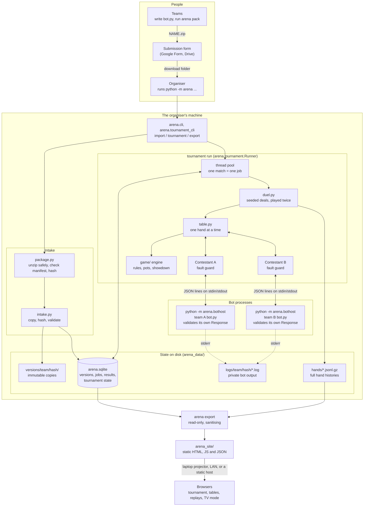
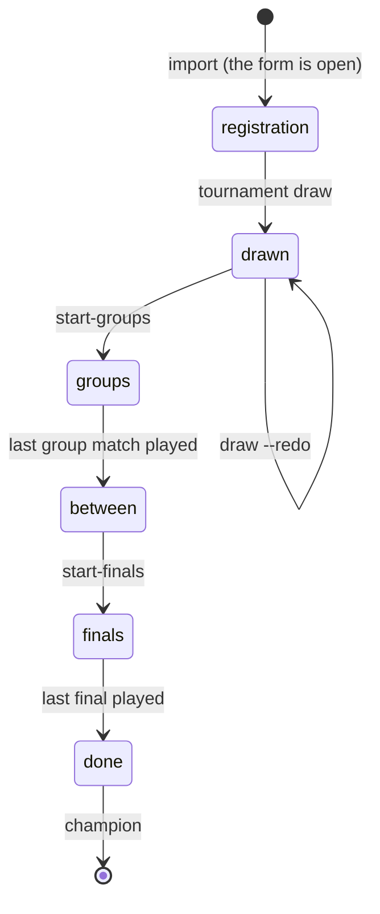

# Competition architecture

This describes how the **bot competition** works: the `arena/` package.
The event uses no HTTP, WebSocket or other network service. Teams hand in their
bots as zip files collected by a form, the organiser imports them, and the bots
run as ordinary child processes on the organiser's machine. All state is local
files plus one SQLite database.

People see the results through a **static website**: `python -m arena export`
turns the results into a folder of plain HTML, CSS, JavaScript and JSON that
can be shown from the laptop or pushed to any static host (see
[section 9](#9-the-results-website)). It contains no server code and never
accepts uploads.

Related documents: [README.md](README.md) (for competitors),
[SUBMITTING.md](SUBMITTING.md) (the competitor guide, also shown on the
website), [ORGANISER.md](ORGANISER.md) (how to run the event),
[docs/history/DESIGN.md](docs/history/DESIGN.md) (why an earlier design was
chosen) and [docs/history/AUDIT.md](docs/history/AUDIT.md) (an earlier rules and
robustness audit). Older code that the event does not use is described in
[Older modes](#11-older-modes-not-used-for-the-event).

## 1. The picture



Network use: the organiser downloads the zips from the form's storage, and,
only if you choose to, serves or pushes the exported site folder. The harness
gives bots no network access of its own (and teams are told not to use any),
but it does not block it either: see [Known limits](#10-known-limits).

## 2. Components

| File | Job |
|---|---|
| `arena/package.py` | `pack` (a team's side): checks a bot, writes `NAME.zip` with a manifest (team name, hash of the files, time). `import_submissions` (the organiser's side): treats each zip as untrusted: refuses unsafe paths, links, duplicate entries, more than 2000 files or 25 MB unzipped, absurd compression ratios, a missing manifest or a checksum that does not match; then submits the bot through `intake.py`. Among several zips for one team, the newest working one (by the time in the manifest) is the one kept. |
| `arena/intake.py` | Submission: copy to `versions/<team>/<hash>/`, content-hash, validate, make current only if valid. Identical code from another team is rejected as copied. |
| `arena/tournament.py` | The two-round tournament: phases, the draw, the match queue, the `Runner`, who is revealed when (section 5). |
| `arena/tournament_cli.py` | The `tournament status / remove / draw / start-groups / run / start-finals` commands. |
| `player_sdk/response.py` | `validate_response`: checks the bot's return value against the rules (section 3). Runs inside the bot's own process. |
| `arena/bothost.py` | The child process that hosts one bot: imports `bot.py`, then loops reading one JSON line and writing one JSON line. Its `print` output is redirected to stderr, so it can never corrupt the protocol. |
| `arena/agents.py` | `ProcessAgent` (talks to a real child process, kills it on timeout, never raises when closing) and `LocalAgent` (in-process, for the built-in baselines and tests). |
| `arena/contestant.py` | The **fault guard**. Turns an exception, timeout, crash, garbage reply or illegal action into a legal fallback (check if free, else fold) and records a fault. After 20 faults, or after overdrawing the thinking-time bank, replaces the bot with an always-fold stub. |
| `arena/table.py` | Plays one hand: asks the engine whose turn it is, asks that contestant, applies the action, repeats until the hand ends. Asserts chips are conserved. Returns a full hand record. |
| `arena/duel.py` | Plays a **pairing**: N seeded deals, each played twice with the seats swapped, bots restarted between the two halves. Produces mean bb/hand and a 95% confidence interval. |
| `arena/stats.py` | Mean, standard error and Student-t confidence intervals. |
| `arena/baselines.py` | `fold`, `call`, `random`, `shove` (also `@fold` etc.; PowerShell needs `'@call'` quoted, so the bare name is the portable form). |
| `arena/specs.py` | Turns `@name` or a path into a contestant. |
| `arena/validate.py` | The smoke test every submission must pass (a short match against `@call`). |
| `arena/store.py` | SQLite storage (WAL mode), the job queue and the stored tournament state. |
| `arena/leaderboard.py` | Ranks teams from the results of one set of jobs (a group, or the finals). |
| `arena/history.py` | Reads and writes gzip JSON-lines hand histories. |
| `arena/export.py` | Builds the static site data: manifest, tournament view, tables, pairings, teams and replays. Decides what is published and strips what must stay private. Also `git_publish`. |
| `arena/serve.py` | A small preview server for the exported folder (no-store caching, pinned MIME types, a deep listen backlog and keep-alive). |
| `arena/jsonutil.py` | Strictly valid JSON (no `Infinity`/`NaN`) and atomic file writes, for everything a browser reads. |
| `arena/site/` | The website itself: `index.html`, `css/`, and `js/` (router, views, replay builder). Copied into the export folder. |
| `arena/cli.py` | The `python -m arena` command line. |
| `game/` | The rules engine: actions, betting, pots, showdown. Shared with the older server. |
| `player_sdk/` | What bot authors import: `PokerBot`, `Response`, `GameState`. The arena reuses its parser and action translation. |

## 3. The bot protocol and the `Response`

Each bot process is started as `python -m arena.bothost <bot.py or folder>` and
speaks one JSON object per line.

```
host   -> bot:  {"type": "act", "state": {...}, "hero_index": 0, "action_history": [...]}
bot    -> host: {"type": "action", "action": "raise_to", "amount": 60}
bot    -> host: {"type": "error", "message": "..."}      the bot raised; it stays alive
host   -> bot:  {"type": "quit"}
```

The first line from the bot is `{"type": "ready"}` once the file imported. If the
import fails the bot sends a fatal `error` instead, and the contestant is
disabled immediately.

Bot authors implement `act(game_state) -> Response`. A `Response` is built with
`Response.fold()`, `Response.call()` (checks when nothing is owed),
`Response.raise_to(total)` (the total chips this betting round) or
`Response.all_in()`. `Action` is kept as an alias of `Response`.

The bot's own process validates what `act` returned, before anything is sent
(`validate_response` in `player_sdk/response.py`, called from
`arena/bothost.py`). It raises `InvalidResponse`, with a sentence saying what to
do instead, when:

* the value is not a `Response` (for example the string `"call"` or `None`);
* a fold, call or check is not among the legal moves;
* a bet or raise is attempted when neither `bet` nor `raise_to` is legal;
* `raise_to(total)` is outside `game_state.min_raise_to` to
  `game_state.max_raise_to`.

An exception (including that one), a timeout or a crash comes back to the
contestant as a fault: a check (else fold) is played in its place, the fault is
counted, and the reason is kept with the match result and on the action in the
hand history. The bot process is restarted after a fault. After 20 faults the
bot is replaced by an always-fold stub for the rest of that match.

## 4. How one pairing is scored

1. A seed picks a shuffle. The same seed always gives the same cards.
2. **Orientation 0:** bot A sits in seat 0, bot B in seat 1. Play the hand.
3. **Orientation 1:** same cards, seats swapped. Play the hand.
4. The deal's value for A is the average of its two net results, in big blinds.
5. Repeat for N deals. Score = mean over deals, with a Student-t 95% interval.

Stacks reset to 2000 chips (100 big blinds) each hand, blinds 10/20. Both bots
are restarted between the two halves so they cannot remember cards from one
orientation to the other. Two properties follow and are tested:

* identical deterministic strategies score exactly 0;
* a bot that folds every hand scores exactly -0.75 bb/hand against a bot that
  never folds.

Limits: 1 s hard limit per move, 0.2 s of thinking per deal per half in total,
20 faults maximum. Defaults can be changed with the `--move-timeout`,
`--think-budget` and `--max-faults` options. A match can also be cut off after
`--time-cap` seconds (`tournament run`, default 1800) and is then scored on the
deals it finished.

## 5. The event life cycle

State is one JSON value in the `meta` table: phase, seed, group size, groups (each
with a `freeze`), finalists, champion. A *freeze* is a fixed set of bot versions;
each group, and the finals, is one freeze with jobs of kind `group` / `final`
(one job = one pairing).



* **Import (`registration`).** `python -m arena import FOLDER` reads every
  `.zip` under the folder. Each is unpacked into a scratch folder with the
  checks in section 2, then submitted: smoke-tested against `@call`, hashed,
  and made the team's current bot only if it passes. A failing version is
  recorded but never replaces a working one. `import` can be repeated; the same
  code twice is "unchanged". `tournament remove TEAM` takes a team out.
* **`draw`.** Random balanced groups of at most `--group-size` teams (a
  reproducible shuffle from a printed seed). It snapshots each team's current
  version into the group's freeze, so later imports change nothing. It can be
  repeated with `--redo` until round 1 starts.
* **`start-groups`.** Queues every pairing of every group. **Round 1** is a
  round robin inside each group.
* **`run`.** The `Runner` (a thread pool, half the CPU count by default) claims
  queued jobs and plays them. State is in the database, so it can be stopped and
  restarted; jobs left "running" by a dead process are put back in the queue at
  startup. When the last job of a round is done, `settle` moves the phase on:
  `between` (finalists chosen: the best `--advance` of each group) or `done`
  (champion chosen).
* **`start-finals`.** Allowed in `between`. It prints a note for any group where
  the last qualifying place is a statistical tie, then queues a round robin
  among the finalists (a new freeze). **Round 2** decides the champion.
* **Scores.** A team's score is its mean bb/hand across its opponents in that
  freeze, each opponent weighted equally, with a combined 95% interval. The
  win/draw/loss record counts only statistically clear pairings, and a tie
  marker flags neighbours that cannot be separated. There is no tie-break stage.

## 6. What is stored where

Everything lives under one folder, `arena_data/` by default (`--root` changes it).

```
arena_data/
  arena.sqlite                          versions, current, freezes, jobs, results, tournament state
  versions/<team>/<hash12>/             immutable copy of each imported version
  hands/<kind>-<jobid>.jsonl.gz         every hand: seeds, cards, board, actions
  logs/<team>/<hash12>/<kind>-vs-<opp>.log   the bot's own prints and tracebacks
```

The SQLite tables are `meta` (including the tournament state), `versions`,
`current`, `freezes`, `freeze_members`, `jobs` and `results`. A unique index
stops the same pairing being queued twice. Each team's bot output goes to its
own `logs/<team>/` folder and is never mixed into results or hand histories.
Nothing enforces access control on those files: whoever can read `arena_data/`
can read every team's code and logs (and so can any bot, see
[Known limits](#10-known-limits)). The exported website never contains them
(section 9), so they stay on the organiser's machine.

A match result stored in `results` carries, among the scores, the list of fault
reasons for each bot (`fault_log_a`, `fault_log_b`).

A hand record in `hands/*.jsonl.gz` looks like this (shortened):

```json
{"hand_index": 0, "deal_seed": 11990938716539812860, "seats": ["starter", "@call"],
 "stacks": [2000, 2000], "hole_cards": [["3D","4C"], ["8H","2C"]],
 "board": ["2H","8D","QS","6H","5C"], "dealer_seat": 0,
 "actions": [{"seat": 0, "action": "post_small_blind", "amount": 10, "street": "preflop", "fault": null}, ...],
 "ended_by": "fold", "net": [-10, 10], "faults": 0, "orientation": 0, "deal": 0}
```

The website export reads the database and writes its own browser-safe copies of
what it publishes.

## 7. How to run it

The step-by-step runbook with real output is [ORGANISER.md](ORGANISER.md). In
short, from the repository root (Python 3.11+, `python -m pip install -r
requirements.txt` once):

**A competitor** (no state is kept):

```bash
python -m arena validate bots/myteam
python -m arena match bots/myteam call --deals 200
python -m arena pack bots/myteam --team myteam
```

**The organiser:**

```bash
python -m arena import downloads
python -m arena tournament draw --group-size 8 --advance 2
python -m arena tournament start-groups --deals 100
python -m arena tournament run                      # leave running
python -m arena tournament start-finals --deals 200 # when status says "between"
python -m arena tournament status
python -m arena export --out arena_site --loop 30 --git-push
```

`run` keeps running until you press Ctrl+C. It plays half the CPU count of
matches at a time (`--concurrency N` changes that).

## 8. How to check it works

**Is the install healthy?** This should print `OK: played 40 hands vs @call with no faults`:

```bash
python -m arena validate bots/starter
```

**Do the tests pass?**

```bash
pytest -m "not integration" -q
ruff check . && ruff format --check .
```

The `integration` tests cover the older server only (they need
`POKER_ADMIN_API_KEY=admin-dev-key`); the competition path is covered by the
`tests/test_arena_*.py` files and `tests/site_js/`.

**Rehearse a whole event** with the example bots: see "Run them as a small
competition" in [bots/README.md](bots/README.md). It packs six bots, imports
them, draws, plays both rounds and takes about a minute.

**Inspect a result during a real event:**

| Question | How |
|---|---|
| Who is in, which phase, how many matches are done? | `python -m arena tournament status` |
| Why did a team get a low score? | Look at its fault count in the tables; the bot's own output is in `arena_data/logs/<team>/<hash>/`; the fault reasons are in the match result and on the action in the hand history. |
| What happened in a hand? | read `arena_data/hands/<kind>-<job>.jsonl.gz` (see below) |

Replay or audit hands from Python:

```python
from arena.history import read_hands

for hand in read_hands("arena_data/hands/final-12.jsonl.gz"):
    print(hand["hand_index"], hand["hole_cards"], hand["board"], hand["net"])
```

## 9. The results website

### What it is

`python -m arena export` writes a folder (default `arena_site/`) with the page
and its data. Plain HTML, CSS and JavaScript: no framework, no build step, and
nothing is loaded from the internet, so it works on a venue network with no
internet. It is read-only.

```
arena_site/
  index.html, css/, js/                 the page (copied from arena/site/)
  data/manifest.json                    title, mode, phase, fingerprint, last change
  data/tournament.json                  phase, groups, qualified teams, finals, champion
  data/leaderboard-final.json           final table (only once the final is complete)
  data/pairings-<group|final>.json      every match (only once its round is complete)
  data/teams.json                       team names and their groups
  data/submitting.md                    the "How to submit" page (SUBMITTING.md)
  data/replays/<kind>-<job>.json        hands for the replayer (per policy)
```

The group tables are inside `tournament.json`. The pages are in
`arena/site/js/views/`: the tournament view (draw, group tables, final table,
champion), the match list, a head-to-head matrix, team pages, a hand replayer,
a TV mode for a projector and the how-to-submit page.

There is no submission form on the site on purpose. This harness has no
sandbox, so a public upload page would let anyone who can reach it run Python on
the organiser's machine. Teams upload to the Google Form instead.

### What it shows, and when

Decided from the stored phase on every export (`_tournament_built` in
`arena/export.py`). Nothing about how anyone is doing leaves the machine until a
round is complete: before that the site is given the draw and the phase and
nothing else (no scores, no pairings, no counts, no who-is-online).

| Phase | What the site has |
|---|---|
| `registration`, `drawn`, `groups` | The phase and, once drawn, the groups. No results. |
| `between`, `finals` | The group tables, the group matches and who qualified. |
| `done` | Also the final table and the champion. |

Because the data does not change while matches are played, a git host is
redeployed at round boundaries, not once per match.

### Run it

```bash
# Show it on this machine: open http://localhost:8000/ (TV mode: /#/tv)
python -m arena export --serve 8000 --loop 15

# Let others on the same network open it (prints the address to share)
python -m arena export --serve 8000 --host 0.0.0.0 --loop 15

# Write the folder once, to host it yourself
python -m arena export --out arena_site

# Keep a git-hosted copy (for example on Vercel) up to date
git clone <your-site-repo> arena_site
python -m arena export --out arena_site --loop 30 --git-push
```

Options: `--title`, `--submit-text` / `--submit-text-file`, `--guide` /
`--no-guide` (the how-to-submit page, `SUBMITTING.md` by default), `--replays`
(`none`, `final` (default) or `all`), `--reveal` (`showdown` (default) or `all`),
`--max-replay-hands` (default 60 per pairing, the biggest swings; 0 = every hand).
Open it through the server, not by double-clicking `index.html`: browsers block
ES modules and `fetch` on `file://` pages.

### Where to host it

| Option | Notes |
|---|---|
| This laptop, on a projector | No network needed. Open `/#/tv`. |
| Same Wi-Fi or LAN | `--host 0.0.0.0`. Venue Wi-Fi sometimes stops devices talking to each other, and Windows usually asks once to allow Python through its firewall: try it before the event. |
| A static host from a git repository (Vercel, GitHub Pages) | `--git-push` commits and pushes after every pass; a push that fails (a dropped connection) is retried on the next pass. Public by default, and git history keeps every version ever pushed. The git mechanics are tested against a local remote (including pushing to an empty clone); **Vercel, GitHub Pages and the deploy delay have not been tried from here.** |
| A tunnel to the laptop | Not built in; point any tunnel tool at the served port. Not tried from here. |

### What is published, and what never is

| Published | Never published |
|---|---|
| Once a round is complete: scores, intervals, records, fault counts, the match list | Bot source code |
| Team names and their groups | Tracebacks, fault messages (a replay keeps only a yes/no flag per move), anything under `logs/` |
| Replays as the policy allows: by default the final only, hole cards only when a hand reached showdown, and the board only as far as it was dealt | A deal's shuffle seed (it reproduces every hidden card), unless `--reveal all` |

Choose the replay policy before the first push to a public host. Hands show how
a bot plays; the default of "final only" publishes them when nothing is left to
adapt. With a git host, a mistake stays in the history.

### How live it is

The page reads a tiny `manifest.json` every 10 s and refetches the larger files
only when its fingerprint changes. `--loop N` re-exports every N seconds, and an
export that changes nothing writes nothing, so a git host gets no empty commits.
Checked in a real browser (with the earlier ladder site): changing the title and
re-exporting updated an open page by itself within 16 s, and stopping the server
left the page showing its last results with a red "Connection lost" notice
instead of an empty screen. With a static host, add that host's deploy time to
the delay.

### Size and speed

In the earlier ladder mode, a first export of 190 + 190 pairings with replays
for the final only took about 9 s and the whole folder was about 15 MB. In the
tournament mode a 6-team rehearsal exported in about a third of a second. An unchanged
re-export rewrites nothing.

### Testing it

`pytest` runs the export, privacy and server tests; `node --test
tests/site_js/` runs the JavaScript tests (`test_site_js.py` runs them for you
if Node is installed). The replay builder is checked against 107 real hands:
what the actions say each seat put in must equal what the engine's own result
implies, which caught deliberately planted bugs that a chip-conservation check
alone missed. The pages themselves were checked by hand in headless Edge on
Windows (desktop, 1080p TV, phone width, light and dark); there is no automated
browser test in the repository.

## 10. Known limits

* **No sandbox.** Bots run as the organiser's user, with the organiser's files,
  network and environment. A bot can read every other team's code in
  `arena_data/`, use the network or damage the machine. Treat the event as
  trust-based, and run it on a throwaway virtual machine or container, or at
  least under a separate user account. The repository's `Dockerfile` builds only
  the older match server, not the arena.
* **No memory or CPU limits are enforced.** Only time and fault limits are. Use
  `ulimit` or a container to add them.
* **The form does not check anything.** A Google Form stores whatever is
  uploaded. Teams are told to run `pack` first; `import` re-checks every zip
  (readable, safe paths, size, checksum, validation) and reports `REJECTED` or
  `INVALID`, but a team that skips `pack` only finds out when the organiser
  imports.
* **Google accounts and deadlines.** Uploading to a Google Form requires every
  respondent to be signed in to a Google account. The form has no automatic
  deadline other than closing it by hand.
* **Impersonation.** Nothing ties a team name to a person. A team can upload a
  zip packed under another team's name, and the newest zip for a name wins. The
  form's response sheet records the verified email of each upload; the organiser
  has to check for one team name with several emails before importing.
* **"Newest" comes from the team's own clock.** It is the time written inside the
  zip by `pack`, not the time of upload.
* **Size.** 25 MB (unzipped) per bot, enforced by `pack` and `import`; the form
  itself is set to allow up to 100 MB.
* **Submissions stop at the draw.** `import` still runs afterwards but a new or
  updated bot is not part of the groups.
* **No tie-break stage** for a close final. The tables flag statistically tied
  neighbours, and `start-finals` warns about a tie at the group cut; extend
  those pairings by hand with more deals.
* **Short all-in raise simplification.** A short all-in raise still re-opens the
  betting for players who already acted.
* **A crash's fault reason is the tail of a traceback.** A mistake in the
  response (wrong type, illegal amount) is reported as one sentence and also
  written to the team's log (`invalid response: ...`). A crash inside `act`
  still gives the last 600 characters of the traceback, which can start in the
  middle of a file path, and `match` shows only the first 300 characters of the
  first fault; `validate` and `pack` print more.
* Tested on Windows with Python 3.14. CI targets Python 3.11 on Linux, which
  has not been observed running; nothing has been run on an HPC yet.
* **The website is read-only and public by construction.** There is no login,
  no upload, and no team-private page: a static host cannot tell teams apart.
  Team logs stay on the organiser's machine.
* **Replays cost information.** Any replay you publish shows how bots play.
  The default publishes the final's only; `--replays all` is a deliberate
  trade-off.
* **Not tried from here:** Vercel and GitHub Pages deployment, a tunnel, a Linux
  or macOS browser, and Safari or Firefox. Only desktop Edge (headless) was used
  for visual checks.

## 11. Older modes (not used for the event)

These parts of the repository still exist and work, but the event does not use
them. They are documented in [docs/legacy-server.md](docs/legacy-server.md).

* **The rolling ladder:** `submit`, `ladder` (with `--submissions`, `--teams`,
  `--cycle SECONDS`, `--registry`), `sync`, `freeze`, `final`, `leaderboard`,
  `status`, `retry-failed`. A ladder plays provisional pairings while teams
  push new versions, then `freeze` snapshots the versions and `final` plays a
  round robin. `ladder --teams` pulls each team's public git repository on a
  schedule (`arena/sync.py`); `--registry` adds self-service registration through
  GitHub issues (`arena/registry.py`); `--cycle` replays every pairing every few
  minutes and pools the results (a round number is part of a job's key and seed).
  When a database has no tournament state, `export` writes the ladder site
  (leaderboard, matrix, matches) instead of the tournament view.
* **The match server:** `server/` (FastAPI, HTTP and WebSocket), `player_sdk.play()`
  and the `poker-bot` command, `admin_sdk/`. Several audit findings are open
  (unauthenticated `viewer_id`, turn-timer stall after an illegal action,
  WebSocket amount validation, `.env` load order, dead-bot forfeits); do not
  expose it to untrusted networks. The `game/` engine is shared with the arena,
  so rules fixes apply to both.
* **Dropped, in git history only:** the websocket gateway and its client, and
  self-registration with join codes and keys (commits `1b1b94a` and `cb39457`).
