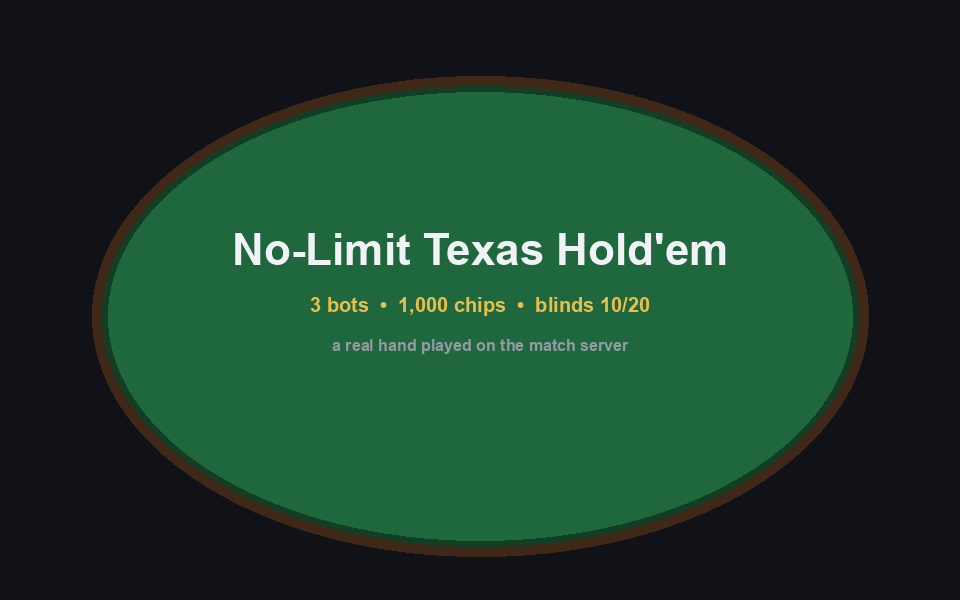
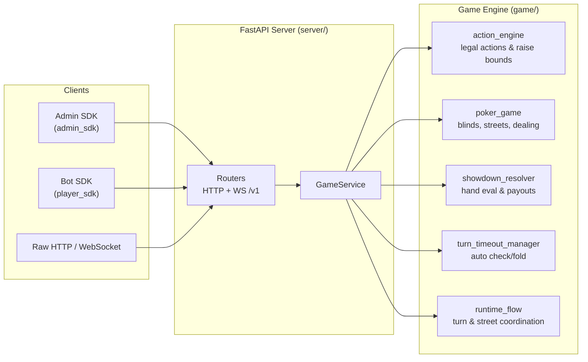

# Poker Bot Infrastructure

An authoritative **no-limit Texas Hold'em match server** for running poker games between bots or client applications — it handles cards, blinds, betting rounds, turn order, timeouts, and showdown payouts, all validated server-side and exposed via HTTP and WebSocket APIs. Built for AI societies, bot competitions, and anyone who needs a trusted referee for programmatic poker.




*A full hand played by three demo bots on the match server (all hole cards shown). To capture a new hand and regenerate the GIF: `python examples/visualisation/capture_demo_hand.py && python examples/visualisation/render_demo_gif.py` (GIF rendering additionally needs [Pillow](https://python-pillow.org): `pip install pillow`).*

## The 30-Second Version

Write a bot, then play it with one call — credentials resolve from keyword arguments or environment variables, exactly like the OpenAI SDK:

```python
# OpenAI                                   # This project
from openai import OpenAI                  from player_sdk import play

client = OpenAI()                          # nothing to instantiate —
response = client.responses.create(        # api_key, server_url, and match_id
    model="gpt-6-astra",                   # are mandatory keyword arguments
    input="Write a bedtime story"          result = play(
)                                               model=MyBot(),              # your bot = the "model"
                                                api_key="dev-key-1",
print(response.output_text)                     server_url="http://host:8000",
                                                match_id="m_123",
                                            )
                                            print(result.summary)
```

```python
from player_sdk.bot_interface import PokerBot
from player_sdk.models import Action, GameState


class MyBot(PokerBot):
    def act(self, game_state: GameState) -> Action:
        if game_state.call_amount == 0:
            return Action.call()          # free card
        if game_state.call_amount <= 20:
            return Action.call()
        return Action.fold()
```

## Running a bot competition (arena)

The `arena/` package is the competition harness. It does **not** use the
server: the organiser runs every bot on one machine (a laptop or one HPC
node), and the rules are the same engine code (`game/`) the server uses.
Heads-up no-limit Hold'em, Python bots.

### Setup (once, everyone)

Python 3.11+ is required. From the repository root:

```bash
python -m venv .venv
source .venv/bin/activate          # Windows PowerShell: .venv\Scripts\Activate.ps1
python -m pip install -r requirements.txt
```

Everything below runs as `python -m arena ...` from the repository root; there
is nothing to build and no server to start. If you see
`ModuleNotFoundError: No module named 'dotenv'`, the requirements are not
installed in the Python you are running.

**Try it in 30 seconds** (the bundled starter bot against a calling station):

```bash
python -m arena validate bots/starter
python -m arena match bots/starter call --deals 50
```

You should see `OK: played 40 hands vs @call with no faults`, then a score line
such as `starter: +0.400 bb/hand (95% CI ...)`. A positive number means the
first bot is winning; the interval says how sure we are.

### For participants: write and test a bot

> Competing? [SUBMITTING.md](SUBMITTING.md) is the one-page guide: write a
> bot, test it, put it in your own public GitHub repository, and give the
> organiser your team name and its address.

1. Copy the starter: `cp -r bots/starter bots/myteam` (a folder with a `bot.py`).
   Six more example bots with different styles are in `bots/` ([bots/README.md](bots/README.md)).
2. Your `bot.py` must define **exactly one** `PokerBot` subclass with a
   no-argument constructor. `act(game_state)` returns `Action.fold()`,
   `Action.call()` (checks when nothing is owed) or `Action.raise_to(total)`
   where `total` is the *total* you want in the pot this betting round, between
   `game_state.min_raise_to` and `game_state.max_raise_to`.
3. Test it against the built-in baselines or another bot. This is the same
   code and scoring the competition uses:

   ```bash
   python -m arena validate bots/myteam                  # loads, plays legally, on time?
   python -m arena match bots/myteam call --deals 200    # vs a calling station
   python -m arena match bots/myteam bots/starter --deals 500 --hands hands.jsonl.gz
   ```

   Baselines: `fold`, `call`, `random`, `shove` (also written `@call` etc.; in
   PowerShell `@` is the splat operator, so quote it as `'@call'` or leave the `@`
   off). A bot folder with the same name always wins. Your bot's `print` output
   and tracebacks go to `arena_logs/<name>.log`.

   Useful `match` options: `--deals N` (each deal is two hands, so more deals
   means a tighter confidence interval; default 100), `--seed N` (repeat the
   exact same cards; default 1), `--hands FILE` (save every hand with cards and
   actions), `--think-budget SECONDS` and `--move-timeout SECONDS` (default 0.2
   and 1.0, the competition values). `python -m arena match --help` lists the
   rest.

   If the output says `faults: yourbot=N` with N above zero, open
   `arena_logs/` and read the log: it holds the traceback or the reason an
   action was rejected.

Rules of the road:

| | |
|---|---|
| **Time** | 1 s hard limit per move (do loading in `__init__`/at import). A thinking-time bank of 0.2 s per deal per half is also enforced; overdrawing it disables the bot for the rest of the pairing. |
| **Faults** | An exception, timeout, crash, bad reply or illegal action is a *fault*: the engine plays a legal fallback (check, else fold) and the bot is restarted if needed. After 20 faults the bot is replaced by an always-fold stub (it loses ~0.75 bb/hand against anything). |
| **State** | Your process lives for a whole run of hands, so you can keep opponent statistics on `self`. It is restarted for the second half of a match, so do not rely on memory across halves. |
| **Libraries** | The organiser's Python environment. Ask before relying on anything beyond the standard library and what `requirements.txt` installs. |
| **Not allowed** | Reading other teams' files, the network, or anything outside your folder. Subprocess isolation is not a sandbox; this is a trust-based rule. |

### How scoring works

* **Duplicate deals.** Every deal (a seeded shuffle) is played twice: once with
  you in seat 0 and once with your opponent there, so both bots play both
  positions with both sets of hole cards. Stacks reset to 100 big blinds every
  hand. This removes most card luck.
* **Score = mean big blinds per hand** against each opponent, with a 95%
  confidence interval over deals. A team's ranking score is its mean over all
  opponents (each weighted equally); the leaderboard shows the interval, a
  win/draw/loss record that only counts *statistically clear* results, and a `~`
  when two neighbouring teams cannot be separated.
* **Ladder vs final.** During the event a *ladder* keeps a provisional round
  robin of everyone's latest versions (about 400 hands per pairing). At the
  deadline the organiser *freezes* the submitted versions and plays a larger
  *final* round robin (about 2,000 hands per pairing) on exactly those versions;
  only the final decides the result.

### For the organiser

State lives under `arena_data/` (change with `--root`): a single SQLite file,
immutable copies of each submitted version, hand histories and private logs.

```bash
# Option 1: watch a folder of <team>/bot.py directories (re-checked every 10 s)
python -m arena ladder --submissions submissions/ --deals 200

# Option 2: submit explicitly (folder, single file, or git URL)
python -m arena submit alpha path/to/alpha-bot
python -m arena submit beta https://github.com/team/beta-bot.git
python -m arena ladder                      # play all missing pairings, keep results fresh

python -m arena status                      # versions and queue
python -m arena leaderboard                 # also writes arena_data/results/leaderboard.json

# at the deadline
python -m arena freeze                      # re-validates every bot, snapshots versions
python -m arena final --deals 1000          # writes arena_data/results/final.json
python -m arena retry-failed && python -m arena final   # if any pairing crashed
```

* Each submission is copied to `versions/<team>/<hash>/`, smoke-tested against
  `@call` and only then becomes the team's current version. A broken push never
  replaces a working bot, identical code is a no-op, and code copied from
  another team is rejected.
* A new version only queues the pairings it takes part in. Pairings run in a
  process pool (`--workers`, default CPUs - 1) with one child process per bot.
* Every pairing writes a gzip hand history with seeds, hole cards, board and
  every action (`arena_data/hands/`), so any result can be audited or replayed.
* **Measured on a 22-thread Windows laptop with cheap bots:** 20 teams, ladder at
  200 deals/pairing (76k hands) in under 2 minutes; final at 1,000 deals/pairing
  (380k hands) in about 5 minutes. Real bot think time adds to this directly.
* **HPC:** nothing needs the network. Run the same commands inside a job with
  `--workers $SLURM_CPUS_PER_TASK`; `arena_data/` must be on a local or POSIX
  filesystem that supports SQLite locking. Use `ulimit` or a container for
  memory/CPU limits; the harness only enforces time and fault limits.

### Collect submissions from the teams' git repositories

Each team keeps its bot in its **own public GitHub repository** (`bot.py` at the
top level) and gives you a team name and the address. You list them in a teams
file, and the arena pulls every repository, checks it, and plays it. Teams
update their bot by pushing; there is nothing for you to copy.

```bash
cp teams.example.txt teams.txt        # PowerShell: Copy-Item teams.example.txt teams.txt
# edit teams.txt: one "team-name  https://github.com/owner/repo  [branch]" per line

python -m arena ladder --teams teams.txt --deals 100       # rolling: pulls every minute
python -m arena sync --teams teams.txt --once              # just fetch and check, once
```

* **`ladder --teams`** pulls every repository once at the start (so the first
  ladder already includes everyone), then again every `--sync-interval` seconds
  (default 60) in the background, and re-plays only the teams whose bot changed.
  Combine it with `--submissions folder/` if some teams hand you files instead.
* **All at once at a deadline:** `sync --once`, then `freeze`, then
  `final --deals 1000`. No ladder is needed. `sync --once` exits non-zero if any
  team has a problem, and lists each one.
* **Edit `teams.txt` while it runs:** it is re-read on every pass, so you can add
  a team mid-event. A mistake in the edit is reported once and the previous list
  keeps being used. Every problem in the file is reported with its line number.
* **What is accepted:** public `https://` repositories only, no password or
  token in the address, `bot.py` at the top level, up to 25 MB, each repository
  and each team once. A broken push never replaces a working bot.
* **What a team sees:** the Submissions page of the results website says whether
  each team's latest fetch worked, and why not (wrong address, private
  repository, no `bot.py`, copied code, a failed check). Give teams
  [SUBMITTING.md](SUBMITTING.md).
* **Not instant:** the arena polls; it is not told when a team pushes. Allow a
  minute plus the match time, and a few minutes more for the website.
* **Trust:** a team's code runs on your computer with no sandbox, so only add
  teams you trust to follow the rules.

### Show the results (website)

`export` turns the results into a **static website**: leaderboard with confidence
intervals, a head-to-head matrix, match lists, team pages, a hand replayer and a
TV mode for a projector. It is plain HTML, CSS and JavaScript with no server
code, so it can be shown from the laptop or pushed to any static host.

```bash
# Show it here: open http://localhost:8000/   (projector: http://localhost:8000/#/tv)
python -m arena export --serve 8000 --loop 15

# Let others on the same network open it (the command prints the address)
python -m arena export --serve 8000 --host 0.0.0.0 --loop 15

# Write the folder once, or keep a git-hosted copy (e.g. GitHub Pages) current
python -m arena export --out arena_site
git clone <your-pages-repo> arena_site
python -m arena export --out arena_site --loop 30 --git-push
```

* **What is public.** Scores, intervals, the match list, team names and whether
  each team's latest push validated. Never bot code, tracebacks or logs. Replays
  are published **for the final only** by default, and hole cards only when a
  hand reached showdown, because replays show how a bot plays. Change it with
  `--replays none|final|all` and `--reveal showdown|all` *before* the first push
  to a public host: a git host keeps its history.
* **Open it through the server**, not by double-clicking `index.html`: browsers
  block ES modules and `fetch` on `file://` pages.
* **It is read-only.** There is no upload form: this harness has no sandbox, so a
  public upload page would let anyone run Python on your machine. Teams submit
  with `submit`, a watched folder or git; `--submit-text "..."` shows
  instructions on the Submissions page.
* **GitHub Pages and a tunnel have not been tried from here;** only the local
  server and the git push (against a local remote) were tested. Details, sizes
  and the privacy rules are in [ARCHITECTURE.md](ARCHITECTURE.md#9-the-results-website).

## Architecture

> **The competition does not use this diagram.** The diagram below is the
> *legacy network server* (HTTP and WebSocket). The bot competition runs bots as
> local subprocesses with no network at all: see
> [ARCHITECTURE.md](ARCHITECTURE.md) for the competition architecture and how to
> run and check it.

### Legacy match server



## Why This Exists

Running a bot poker competition without a trusted server means every participant re-implements the rules — and disputes over illegal actions, mis-dealt cards, and incorrect payouts are inevitable. This project solves that by making the **server authoritative**: all rules, state transitions, and settlements are validated centrally, so bots can only ever submit an action and observe the result.

It stands out because it is batteries-included — a complete hand engine, admin and player SDKs, per-turn timeouts, real-time WebSocket updates, and a benchmark suite for the engine hot paths — with no database or external services required to run a match.

## Key Features

- **Authoritative no-limit Texas Hold'em engine** — blinds, `preflop → flop → turn → river → showdown`, main and side pots, uncalled bets returned, split pots with the odd chip to the first seat left of the button, seedable shuffles
- **Competition arena** — a local harness that plays bots as isolated subprocesses in heads-up *duplicate* matches, with a live ladder and a frozen final round robin ([details](#running-a-bot-competition-arena))
- **Results website** — a static, read-only site (leaderboard with confidence intervals, head-to-head matrix, hand replays, TV mode) that refreshes itself; show it from a laptop or push it to a static host ([details](#show-the-results-website))
- **Multi-hand matches** — matches play hand after hand (with a rotating dealer button and blind-skipping for eliminated players) until one player owns every chip, or until an optional `max_hands` cap is reached
- **Auto-start readiness gate** — `start_match` arms the match; dealing begins automatically once every player's websocket is live, so the first turn never races a cold-starting bot (`force` start or `wait_for_players=False` for HTTP-only setups)
- **Strict action validation** — only legal actions (`fold`, `check`, `call`, `bet`, `raise_to`) with server-computed raise bounds are accepted
- **Turn timeouts** — players who stall are auto-checked, or auto-folded when checking is illegal
- **HTTP + WebSocket APIs** — poll match state or receive turn events in real time at `ws://…/v1/ws`
- **OpenAI-style player SDK** — `play(model=MyBot(), api_key=...)` joins a match and plays to completion over a realtime websocket, with automatic HTTP-polling fallback and auto-discovery of identity, match, and seat
- **Admin SDK** — match lifecycle (create, start, pause, resume, end) with separate admin keys
- **Local test harness** — `play_local_match([bot_a, bot_b])` auto-starts a server and runs a full game for fast iteration
- **Test suite** — pytest unit tests plus end-to-end integration tests that play real matches
- **Benchmark suite** — measures action validation, state projection, hand evaluation, and broadcast fanout

## Quick Start

**Prerequisites:** Python 3.11+ and `pip`.

```bash
# 1. Clone
git clone https://github.com/Manchester-AI-Society/poker_bot_infrastructure.git
cd poker_bot_infrastructure

# 2. Create and activate a virtual environment
python3 -m venv .venv
source .venv/bin/activate

# 3. Install dependencies and the player SDK (+ poker-bot CLI)
python -m pip install -r requirements.txt
python -m pip install -e ".[dev]"

# 4. Configure environment variables (dev keys included)
cp exampleenv .env

# 5. Start the server
uvicorn server.run_poker_server:app --reload --host 0.0.0.0 --port 8000

# 6. Verify it is running (in a second terminal)
curl http://127.0.0.1:8000/health
```

The `exampleenv` file ships dev keys (`admin-dev-key`, `dev-key-1` … `dev-key-3`) so everything works out of the box.

### Run with Docker (optional)

```bash
# 1. Configure environment variables (dev keys included)
cp exampleenv .env

# 2. Build and start the containerised server
docker compose up --build -d

# 3. Verify it is running
curl http://127.0.0.1:8000/health
```

The image (`Dockerfile`) contains only the server and engine — the SDKs, examples, and tests are used from your local checkout, connecting to `http://127.0.0.1:8000` as usual. API keys come from `.env` (`BOT_API_KEYS` / `ADMIN_API_KEYS`; dev keys apply when unset), and the container defines a healthcheck against `/health`. To run the container directly instead of via compose:

```bash
docker build -t poker-bot-server .
docker run --rm -p 8000:8000 --env-file .env poker-bot-server
```


**Fastest path to a full game** — example scripts auto-start the server if needed:

```bash
# A) Two bots against each other, fully local, one command
python examples/bots/testing/run_local_test_match.py

# B) The remote flow: create a match, then connect bots to it
python examples/admin/admin_flows.py single       # prints the match_id
POKER_API_KEY=dev-key-1 POKER_MATCH_ID=<match-id> \
  python examples/bots/remote/run_remote_bot.py
# (optionally, a second bot in a third terminal)
POKER_API_KEY=dev-key-2 POKER_MATCH_ID=<match-id> \
  python examples/bots/remote/run_remote_bot.py
```

## Playing with the SDK

### 1. Write a bot (implement one method)

Your bot is the "model". It sees a fully redacted `GameState` (hole cards, stacks, pot, board, legal actions, action history) and returns one `Action`:

```python
from player_sdk.bot_interface import PokerBot
from player_sdk.models import Action, GameState


class MyBot(PokerBot):
    def act(self, game_state: GameState) -> Action:
        if game_state.call_amount == 0:
            return Action.call()          # free card
        if game_state.call_amount <= 20:
            return Action.call()
        return Action.fold()
```

### 2. `play()` — the one-call API

`api_key`, `server_url`, and `match_id` are **mandatory** keyword
arguments — you pass everything through the call itself, exactly like
naming a model in the OpenAI SDK:

```python
from player_sdk import play

result = play(
    model=MyBot(),
    api_key="dev-key-1",            # required — your bot key
    server_url="http://host:8000",  # required — where the server lives
    match_id="m_123",               # required — which game you're in
)
print(result.summary)               # one-line final result
```

Your player identity and seat are still auto-discovered from the API
key and the match's players list — nothing else to configure.

| Parameter | Required | Default | Notes |
|---|---|---|---|
| `model` | ✔ | — | Your `PokerBot` instance |
| `api_key` | ✔ | — | Bot key issued by the organiser |
| `server_url` | ✔ | — | Server base URL |
| `match_id` | ✔ | — | The game you were assigned |
| `player_id` | | resolved via `GET /v1/me` | Rarely needed |
| `timeout_seconds` | | `10.0` | HTTP request timeout |
| `transport` | | `"auto"` | `"auto"`, `"ws"`, or `"http"` |
| `poll_interval_seconds` | | `0.5` | HTTP polling interval |
| `verbose` | | `True` | Progress and result printing |

Omitting a mandatory argument raises a `TypeError`; passing an empty
string raises a `ValueError` naming the parameter. Environment
variables are **not** consulted by `play()` — if you prefer env-driven
configuration, use the CLI or `run_bot()` (below), which resolve
`POKER_API_KEY`, `POKER_SERVER_URL`, `POKER_MATCH_ID`,
`POKER_PLAYER_ID`, and `POKER_TIMEOUT_SECONDS` from the environment
and `.env`.

`play()` returns the final `GameState`; `result.summary` is the
one-line result (`status=finished, winner=dev-bot-2 (1020 chips),
stacks: …`), and the full state (stacks, board, history, ids) is
available on the object itself.

### 3. Transports

- **`"auto"` (default)** — connects to the server's realtime websocket (`/v1/ws`): turns arrive as pushed `your_turn` events, actions go back on the same socket, and identity comes from the `connected` handshake. If the websocket cannot be established, `play()` prints a notice and transparently falls back to HTTP polling.
- **`"ws"`** — websocket only; connection failures raise instead of falling back.
- **`"http"`** — classic polling (two GETs per interval); works everywhere.

The websocket runner is resilient: it reconnects with backoff after drops, recovers missed turns with periodic HTTP checks while idle, and raises a clean auth error if the key is rejected (close code `4401`).

### 4. The `poker-bot` CLI

Installed with `pip install -e .`:

```bash
POKER_SERVER_URL=http://host:8000 POKER_API_KEY=dev-key-1 \
  poker-bot my_bot.py
```

From a checkout you can also run the same CLI as a module, no install needed:

```bash
POKER_API_KEY=dev-key-1 python -m player_sdk my_bot.py
```

Flags: `--transport {auto,ws,http}`, `--api-key`, `--server-url`, `--match-id`, `--poll-interval`. The bot file must define exactly one `PokerBot` subclass with a no-argument constructor.

### 5. Test your bot locally (one call)

Before connecting remotely, `player_sdk.testing.play_local_match`
starts a local server if needed, registers the bots, and drives the
whole game to completion:

```python
from examples.bots.conservative_bot import ExampleConservativeBot
from player_sdk.testing import play_local_match

result = play_local_match([MyBot(), ExampleConservativeBot()])
print(result.winner_id, result.final_stacks)
```

Or just run the bundled example:

```bash
python examples/bots/testing/run_local_test_match.py
```

### 6. Useful `GameState` fields for bot authors

| Field / property | Meaning |
|---|---|
| `hole_cards`, `community_cards` | Your cards and the revealed board |
| `my_stack`, `my_bet`, `to_call` | Your chips, current-round commitment, price to call |
| `call_amount == 0` | You can check |
| `min_raise_to` / `max_raise_to` | Bounds for `Action.raise_to(amount)` |
| `legal_actions` | Engine-level legal actions this turn |
| `action_history` | Visible past actions as `ActionRecord`s |
| `is_preflop` … `is_showdown` | Street helpers |
| `status` | `waiting` / `running` / `paused` / `finished` |

## Running a Game (admin)

### Admin SDK

A match is a **sequence of hands played until one player owns every chip** (or
until an optional `max_hands` cap). The dealer button rotates each hand and
eliminated players are skipped.

```python
from admin_sdk import AdminSDKClient, AdminSDKConfiguration
from admin_sdk.models import MatchCreationOptions

client = AdminSDKClient(AdminSDKConfiguration.from_environment())

created = client.create_match(
    MatchCreationOptions(
        player_ids=["dev-bot-1", "dev-bot-2"],
        number_of_bots_allowed=2,
        starting_stack=1000,
        small_blind=10,
        big_blind=20,
        turn_timeout_seconds=15,
        event_log_limit=2000,
        max_hands=None,           # None = play to bust-out
        wait_for_players=True,    # arm: deal once all websockets are live
    )
)
client.start_match(created["match_id"])
```

With `wait_for_players=True` (the default), `start_match` **arms** the match:
it returns `{"status": "waiting", "armed": true}` and the first hand is dealt
automatically the moment every listed player has a live websocket — the first
turn never races a bot that is still starting up. Pass `force=True` to
`start_match` (or `wait_for_players=False` at creation) to deal immediately,
which is what HTTP-only setups and the local test harness do.

More examples in [`examples/admin/admin_flows.py`](examples/admin/admin_flows.py): creating several matches (`multi`), per-request key overrides (`single --key-override`), and an auth-failure demo (`no-key`).

### Raw REST (no SDK)

```bash
# Create a match (admin key)
curl -X POST http://127.0.0.1:8000/v1/matches \
  -H "X-Admin-Key: admin-dev-key" \
  -H "Content-Type: application/json" \
  -d '{"player_ids": ["dev-bot-1", "dev-bot-2"], "starting_stack": 1000,
       "small_blind": 10, "big_blind": 20, "turn_timeout_seconds": 15,
       "event_log_limit": 2000}'

# Submit a player action (bot key)
curl -X POST http://127.0.0.1:8000/v1/matches/<MATCH_ID>/actions/self \
  -H "X-API-Key: dev-key-1" \
  -H "Content-Type: application/json" \
  -d '{"action": "raise_to", "amount": 60, "turn_id": 3}'

# Read the event log
curl "http://127.0.0.1:8000/v1/matches/<MATCH_ID>/events?offset=0&limit=100"
```

## Tests

```bash
pytest -m "not integration" -q   # fast suite, about 40 s: use this day to day
pytest tests/test_arena_table.py -v   # one file
ruff check . && ruff format --check .   # lint, as CI does
node --test tests/site_js/*.test.mjs  # the website's JavaScript (needs Node 18+)

# server integration tests: real matches over HTTP and WebSocket, about 2 min.
# They need the dev admin key from exampleenv in the environment:
POKER_ADMIN_API_KEY=admin-dev-key pytest -m integration -q
# Windows PowerShell:  $env:POKER_ADMIN_API_KEY = "admin-dev-key"; pytest -m integration -q
```

**Expected result of the fast suite:** about 178 passed, 3 deselected (the
integration tests) and 6 xfailed. The 6 xfails are not failures: they are tests
that reproduce known server-only bugs listed in [AUDIT.md](AUDIT.md) (C3, C4,
H4, H5, H9) and are marked `xfail(strict=True)`. When one of those bugs is
fixed its test starts passing, which strict mode reports as a failure, and you
then delete the marker.

### What the tests cover

| Area | Files | What they check |
|---|---|---|
| Rules | `test_showdown_pots.py`, `test_betting_rules.py`, `test_action_order.py` | Side pots, uncalled bets returned, odd chips, short all-ins, who acts first on every street |
| Determinism | `test_seeded_deal.py` | The same seed gives the same cards; different seeds differ |
| Table | `test_arena_table.py` | A hand played through the arena conserves chips; a fuzz test plays about 3,000 random hands (2 and 3 seats, uneven stacks) and asserts no chips are created or lost |
| Scoring | `test_arena_duel.py` | Identical bots score exactly 0; a bot that folds every hand loses exactly 0.75 bb/hand; scores are antisymmetric when the bots swap sides; both orientations of every deal are played; same seed reproduces |
| Bot failures | `test_arena_process.py` | Real subprocess bots that crash, hang, print garbage, return illegal actions or fail to import, and that the match still finishes with faults recorded |
| Competition flow | `test_arena_competition.py`, `test_arena_cli.py` | Submit, version by content hash, ladder only re-runs changed pairings, freeze, final, retry, and every CLI command |
| Results site | `test_arena_export.py`, `test_arena_serve.py`, `test_arena_site_assets.py`, `test_site_js.py`, `tests/site_js/` | What is published and what never is (tracebacks, seeds, folded hole cards), valid JSON, replay policy, git push and retry, the preview server, and the page's own files; the JavaScript tests replay 107 real hands and check them against the engine's results |
| Audit repros | `test_audit_regressions.py` | Regression tests for fixed audit findings; the deferred ones stay as strict xfails |
| SDK | `test_client_actions.py`, `test_parser.py`, ... | Action translation and state parsing |

### Check the whole competition on your machine

A rehearsal of the whole event (submit, ladder, freeze, final) with three teams
on a laptop takes well under a minute. Bash shown; on Windows use any scratch
folder in place of `/tmp`.

```bash
for t in alpha beta gamma; do
  mkdir -p /tmp/field/$t
  cp bots/starter/bot.py /tmp/field/$t/
  echo "# team $t" >> /tmp/field/$t/bot.py     # see the note below
done

python -m arena ladder --submissions /tmp/field --root /tmp/rehearsal --deals 20 --once
python -m arena status      --root /tmp/rehearsal
python -m arena freeze      --root /tmp/rehearsal
python -m arena final       --root /tmp/rehearsal --deals 50
python -m arena leaderboard --root /tmp/rehearsal --kind final
```

Expected: three `valid` submissions, `pairings 3/3`, and a final table. Here
every team runs the same strategy, so every score is exactly `+0.000`: a useful
sanity check, because duplicate scoring means identical bots cannot be separated
by luck. Swap in real, different bots to see a real ranking.

The `echo` line matters. A submission whose code is byte-identical to another
team's current bot is treated as copied and silently not added, so identical
files would give you a one-team leaderboard. Results are written to
`/tmp/rehearsal/results/` (`leaderboard.json`, `final.json`). Always use a
throwaway `--root` for rehearsals so they never mix with the real event's
`arena_data/`.

### Server and SDK tests

The older half of the suite covers config resolution order, action validation
and translation, parser payload tolerance, action-history parsing from the
server event log, authenticated action submission, websocket message
handling (fake socket, no server needed), the `play()` dispatch and
fallback logic, multi-hand progression and the start-readiness gate,
and end-to-end matches played both through the local harness and over
the websocket transport with `play()`.

**Version note:** the websocket protocol pairs the server and SDK from
the same checkout. A new server with a pre-multi-hand SDK would make
those older bots exit at the first hand's showdown — upgrade both
together.

## Troubleshooting

| Symptom | Cause and fix |
|---|---|
| `ValueError: The api_key option must be set…` | No key in kwargs, env, or `.env` — pass `api_key=…` or set `POKER_API_KEY` |
| `PlayerSDKError: Could not reach server` | Server down or wrong `server_url` — check `curl <server>/health` |
| `PlayerSDKAuthError: Invalid API key` (or websocket close 4401) | Key not in the server's `BOT_API_KEYS` |
| `PlayerSDKAuthError: An API key is required to submit actions` | Submitting actions over HTTP without a key is no longer allowed — pass `api_key` to `play()`/the client |
| `Player belongs to multiple matches` | Set `match_id` (or `POKER_MATCH_ID`) explicitly when using the CLI or `run_bot()` |
| `Websocket unavailable …; using HTTP polling instead` | The server accepted HTTP but rejected the WS upgrade — everything still works, this is informational |
| Bot folded without acting | Turn timer (`turn_timeout_seconds`) expired; make `act()` return faster or raise the match timeout |
| `error: the following arguments are required: bot_b` in PowerShell | PowerShell treats `@call` as its splat operator and drops it. Write `call` (no `@`) or quote it: `'@call'` |
| `ModuleNotFoundError: No module named 'dotenv'` when running `python -m arena` | Requirements not installed in this Python: `python -m pip install -r requirements.txt` |
| `arena validate` says the bot failed to load | Your file needs exactly one `PokerBot` subclass with a no-argument constructor; the traceback is in `arena_logs/` |
| `faults:` is non-zero in a match | Exception, timeout or illegal action in your bot; read `arena_logs/<name>.log`. 20 faults disables the bot |
| A submission is rejected as a duplicate | Its code is identical to another team's current bot |
| A final has a crashed pairing | `python -m arena retry-failed`, then `python -m arena final` again; only the missing pairings run |
| The website shows "The results could not be loaded" | The page cannot reach `data/manifest.json`: run `python -m arena export` first, and open the page through `--serve` (or any web server), not from a `file://` path |
| The website says "Connection lost" in red | The server or network went away; the page keeps the last results and retries every 10 s |
| `export failed: no competition data found` | `--root` does not contain `arena.sqlite`; submit a bot or run the ladder first |
| Others cannot open the site on your Wi-Fi | Use `--host 0.0.0.0`, allow Python through the firewall, and check the venue network lets devices reach each other |
| Integration tests fail on authentication or admin-key errors | Set `POKER_ADMIN_API_KEY=admin-dev-key` (the value in `exampleenv`) in the environment before running them |

## Benchmarks

Measure engine hot paths before and after optimisations:

```bash
python benchmarks/run_benchmarks.py                                   # full suite
python benchmarks/run_benchmarks.py --only showdown_evaluator_7card   # one scenario
python benchmarks/run_benchmarks.py --json-output benchmarks/latest.json
```

## Project Layout

```
arena/          Competition harness: bot host, duplicate matches, ladder, final, CLI
arena/site/     The results website (HTML, CSS, JavaScript), copied out by `arena export`
bots/           Starter bot and six example bots with different styles (see bots/README.md)
player_sdk/     Player SDK: play(), PokerBot interface, WS + HTTP transports, CLI
admin_sdk/      Admin SDK: match lifecycle management
server/         FastAPI routers, auth, websocket gateway
game/           Authoritative engine: actions, streets, showdown, timeouts
examples/       bots, remote play, local testing, admin flows, visualisation
tests/          pytest unit + integration suites
benchmarks/     engine hot-path benchmarks
AUDIT.md        Phase 1 audit (bugs, robustness, fairness) and fix status
DESIGN.md       Competition design options and the chosen architecture
ARCHITECTURE.md How the competition works, and how to run and check it
```

**Server mode vs arena.** The FastAPI server and `play()` remain for live
network matches, but they are not used by the competition. Several server-only
findings from [AUDIT.md](AUDIT.md) are intentionally still open (unauthenticated
`viewer_id`, turn-timer stall after an illegal action, WebSocket amount
validation, `.env` load order, dead-bot forfeits); do not expose the server to
untrusted networks until they are fixed.

## Contributing

1. **Fork** the repo on GitHub and clone your fork.
2. **Set up** your environment following [Quick Start](#quick-start) (step 3 installs ruff and pytest via `.[dev]`).
3. **Branch**: `git checkout -b feat/my-feature`.
4. **Make changes**, keeping code style clean:

   ```bash
   ruff check .
   ruff format --check .
   ```

5. **Test** your changes:

   ```bash
   pytest
   python examples/bots/testing/run_local_test_match.py
   ```

6. **Open a pull request** against `main` with a clear description of the change and how you verified it.

## License

This project is licensed under the [MIT License](LICENSE).
