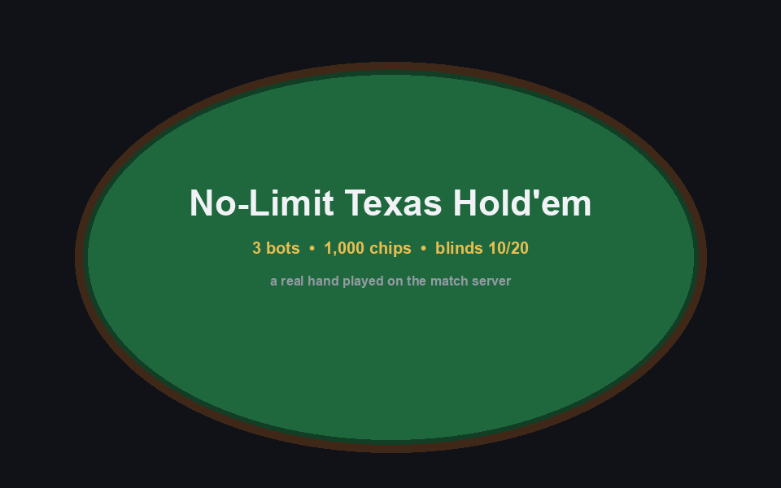
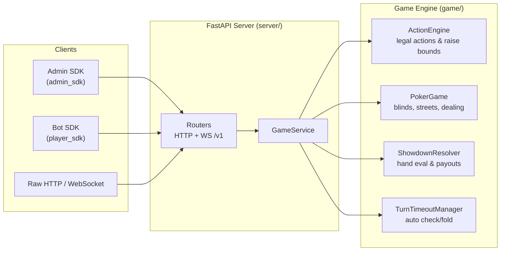

# Poker Bot Infrastructure

An authoritative **no-limit Texas Hold'em match server** for running poker games between bots or client applications — it handles cards, blinds, betting rounds, turn order, timeouts, and showdown payouts, all validated server-side and exposed via HTTP and WebSocket APIs. Built for AI societies, bot competitions, and anyone who needs a trusted referee for programmatic poker.




*A full hand played by three demo bots on the match server (all hole cards shown). To capture a new hand and regenerate the GIF: `python examples/visualisation/capture_demo_hand.py && python examples/visualisation/render_demo_gif.py`.*

## The 30-Second Version

Write a bot, then play it with one call — credentials resolve from keyword arguments or environment variables, exactly like the OpenAI SDK:

```python
# OpenAI                                   # This project
from openai import OpenAI                  from player_sdk import play

client = OpenAI()                          # nothing to instantiate —
response = client.responses.create(        # api_key, server_url, and match_id
    model="gpt-6-astra",                   # are mandatory keyword arguments
    input="Write a bedtime story"          result = play(
)                                               model=MyBot(),              # your bot = the "model"
                                                api_key="dev-key-1",
print(response.output_text)                     server_url="http://host:8000",
                                                match_id="m_123",
                                            )
                                            print(result.summary)
```

```python
from player_sdk.bot_interface import PokerBot
from player_sdk.models import Action, GameState


class MyBot(PokerBot):
    def act(self, game_state: GameState) -> Action:
        if game_state.call_amount == 0:
            return Action.call()          # free card
        if game_state.call_amount <= 20:
            return Action.call()
        return Action.fold()
```

## Architecture



## Why This Exists

Running a bot poker competition without a trusted server means every participant re-implements the rules — and disputes over illegal actions, mis-dealt cards, and incorrect payouts are inevitable. This project solves that by making the **server authoritative**: all rules, state transitions, and settlements are validated centrally, so bots can only ever submit an action and observe the result.

It stands out because it is batteries-included — a complete hand engine, admin and player SDKs, per-turn timeouts, real-time WebSocket updates, and a benchmark suite for the engine hot paths — with no database or external services required to run a match.

## Key Features

- **Authoritative no-limit Texas Hold'em engine** — blinds, `preflop → flop → turn → river → showdown`, side-pot-free settlement with split-pot chip distribution
- **Strict action validation** — only legal actions (`fold`, `check`, `call`, `bet`, `raise_to`) with server-computed raise bounds are accepted
- **Turn timeouts** — players who stall are auto-checked, or auto-folded when checking is illegal
- **HTTP + WebSocket APIs** — poll match state or receive turn events in real time at `ws://…/v1/ws`
- **OpenAI-style player SDK** — `play(model=MyBot(), api_key=...)` joins a match and plays to completion over a realtime websocket, with automatic HTTP-polling fallback and auto-discovery of identity, match, and seat
- **Admin SDK** — match lifecycle (create, start, pause, resume, end) with separate admin keys
- **Local test harness** — `play_local_match([bot_a, bot_b])` auto-starts a server and runs a full game for fast iteration
- **Test suite** — pytest unit tests plus end-to-end integration tests that play real matches
- **Benchmark suite** — measures action validation, state projection, hand evaluation, and broadcast fanout

## Quick Start

**Prerequisites:** Python 3.11+ and `pip`.

```bash
# 1. Clone
git clone https://github.com/Manchester-AI-Society/poker_bot_infrastructure.git
cd poker_bot_infrastructure

# 2. Create and activate a virtual environment
python3 -m venv .venv
source .venv/bin/activate

# 3. Install dependencies and the player SDK (+ poker-bot CLI)
python -m pip install -r requirements.txt
python -m pip install -e ".[dev]"

# 4. Configure environment variables (dev keys included)
cp exampleenv .env

# 5. Start the server
uvicorn server.run_poker_server:app --reload --host 0.0.0.0 --port 8000

# 6. Verify it is running (in a second terminal)
curl http://127.0.0.1:8000/health
```

The `exampleenv` file ships dev keys (`admin-dev-key`, `dev-key-1` … `dev-key-3`) so everything works out of the box.

**Fastest path to a full game** — example scripts auto-start the server if needed:

```bash
# A) Two bots against each other, fully local, one command
python examples/bots/testing/run_local_test_match.py

# B) The remote flow: create a match, then connect bots to it
python examples/admin/create_one_game_with_api_key.py   # prints the match_id
POKER_API_KEY=dev-key-1 POKER_MATCH_ID=<match-id> \
  python examples/bots/remote/run_remote_bot.py
# (optionally, a second bot in a third terminal)
POKER_API_KEY=dev-key-2 POKER_MATCH_ID=<match-id> \
  python examples/bots/remote/run_remote_bot.py
```

## Playing with the SDK

### 1. Write a bot (implement one method)

Your bot is the "model". It sees a fully redacted `GameState` (hole cards, stacks, pot, board, legal actions, action history) and returns one `Action`:

```python
from player_sdk.bot_interface import PokerBot
from player_sdk.models import Action, GameState


class MyBot(PokerBot):
    def act(self, game_state: GameState) -> Action:
        if game_state.call_amount == 0:
            return Action.call()          # free card
        if game_state.call_amount <= 20:
            return Action.call()
        return Action.fold()
```

### 2. `play()` — the one-call API

`api_key`, `server_url`, and `match_id` are **mandatory** keyword
arguments — you pass everything through the call itself, exactly like
naming a model in the OpenAI SDK:

```python
from player_sdk import play

result = play(
    model=MyBot(),
    api_key="dev-key-1",            # required — your bot key
    server_url="http://host:8000",  # required — where the server lives
    match_id="m_123",               # required — which game you're in
)
print(result.summary)               # one-line final result
```

Your player identity and seat are still auto-discovered from the API
key and the match's players list — nothing else to configure.

| Parameter | Required | Default | Notes |
|---|---|---|---|
| `model` | ✔ | — | Your `PokerBot` instance |
| `api_key` | ✔ | — | Bot key issued by the organiser |
| `server_url` | ✔ | — | Server base URL |
| `match_id` | ✔ | — | The game you were assigned |
| `player_id` | | resolved via `GET /v1/me` | Rarely needed |
| `timeout_seconds` | | `10.0` | HTTP request timeout |
| `transport` | | `"auto"` | `"auto"`, `"ws"`, or `"http"` |
| `poll_interval_seconds` | | `0.5` | HTTP polling interval |
| `verbose` | | `True` | Progress and result printing |

Omitting a mandatory argument raises a `TypeError`; passing an empty
string raises a `ValueError` naming the parameter. Environment
variables are **not** consulted by `play()` — if you prefer env-driven
configuration, use the CLI or `run_bot()` (below), which resolve
`POKER_API_KEY`, `POKER_SERVER_URL`, `POKER_MATCH_ID`,
`POKER_PLAYER_ID`, and `POKER_TIMEOUT_SECONDS` from the environment
and `.env`.

`play()` returns the final `GameState`; `result.summary` is the
one-line result (`status=finished, winner=dev-bot-2 (1020 chips),
stacks: …`), and the full state (stacks, board, history, ids) is
available on the object itself.

### 3. Transports

- **`"auto"` (default)** — connects to the server's realtime websocket (`/v1/ws`): turns arrive as pushed `your_turn` events, actions go back on the same socket, and identity comes from the `connected` handshake. If the websocket cannot be established, `play()` prints a notice and transparently falls back to HTTP polling.
- **`"ws"`** — websocket only; connection failures raise instead of falling back.
- **`"http"`** — classic polling (two GETs per interval); works everywhere.

The websocket runner is resilient: it reconnects with backoff after drops, recovers missed turns with periodic HTTP checks while idle, and raises a clean auth error if the key is rejected (close code `4401`).

### 4. The `poker-bot` CLI

Installed with `pip install -e .`:

```bash
POKER_SERVER_URL=http://host:8000 POKER_API_KEY=dev-key-1 \
  poker-bot my_bot.py
```

Flags: `--transport {auto,ws,http}`, `--api-key`, `--server-url`, `--match-id`, `--poll-interval`. The bot file must define exactly one `PokerBot` subclass with a no-argument constructor.

### 5. Test your bot locally (one call)

Before connecting remotely, `player_sdk.testing.play_local_match`
starts a local server if needed, registers the bots, and drives the
whole game to completion:

```python
from examples.bots.conservative_bot import ExampleConservativeBot
from player_sdk.testing import play_local_match

result = play_local_match([MyBot(), ExampleConservativeBot()])
print(result.winner_id, result.final_stacks)
```

Or just run the bundled example:

```bash
python examples/bots/testing/run_local_test_match.py
```

### 6. Useful `GameState` fields for bot authors

| Field / property | Meaning |
|---|---|
| `hole_cards`, `community_cards` | Your cards and the revealed board |
| `my_stack`, `my_bet`, `to_call` | Your chips, current-round commitment, price to call |
| `call_amount == 0` | You can check |
| `min_raise_to` / `max_raise_to` | Bounds for `Action.raise_to(amount)` |
| `legal_actions` | Engine-level legal actions this turn |
| `action_history` | Visible past actions as `ActionRecord`s |
| `is_preflop` … `is_showdown` | Street helpers |
| `status` | `waiting` / `running` / `paused` / `finished` |

## Running a Game (admin)

### Admin SDK

```python
from admin_sdk import AdminSDKClient, AdminSDKConfiguration
from admin_sdk.models import MatchCreationOptions

client = AdminSDKClient(AdminSDKConfiguration.from_environment())

created = client.create_match(
    MatchCreationOptions(
        player_ids=["dev-bot-1", "dev-bot-2"],
        number_of_bots_allowed=2,
        starting_stack=1000,
        small_blind=10,
        big_blind=20,
        turn_timeout_seconds=15,
        event_log_limit=2000,
        table_label="single-table",
        tournament_round="round-1",
    )
)
client.start_match(created["match_id"])
```

More examples in [`examples/admin/`](examples/admin): creating several matches, per-request key overrides, and auth-failure demos.

### Raw REST (no SDK)

```bash
# Create a match (admin key)
curl -X POST http://127.0.0.1:8000/v1/matches \
  -H "X-Admin-Key: admin-dev-key" \
  -H "Content-Type: application/json" \
  -d '{"player_ids": ["dev-bot-1", "dev-bot-2"], "starting_stack": 1000,
       "small_blind": 10, "big_blind": 20, "turn_timeout_seconds": 15,
       "event_log_limit": 2000}'

# Submit a player action (bot key)
curl -X POST http://127.0.0.1:8000/v1/matches/<MATCH_ID>/actions/self \
  -H "X-API-Key: dev-key-1" \
  -H "Content-Type: application/json" \
  -d '{"action": "raise_to", "amount": 60, "turn_id": 3}'

# Read the event log
curl "http://127.0.0.1:8000/v1/matches/<MATCH_ID>/events?offset=0&limit=100"
```

## Tests

```bash
pytest                        # everything (integration tests start a local server)
pytest -m "not integration"   # fast unit suite only
pytest tests/test_ws_runner.py -v
```

The suite covers config resolution order, action validation and
translation, parser payload tolerance, websocket message handling
(fake socket, no server needed), the `play()` dispatch and fallback
logic, and end-to-end matches played both through the local harness
and over the websocket transport with `play()`.

## Troubleshooting

| Symptom | Cause and fix |
|---|---|
| `ValueError: The api_key option must be set…` | No key in kwargs, env, or `.env` — pass `api_key=…` or set `POKER_API_KEY` |
| `PlayerSDKError: Could not reach server` | Server down or wrong `server_url` — check `curl <server>/health` |
| `PlayerSDKAuthError: Invalid API key` (or websocket close 4401) | Key not in the server's `BOT_API_KEYS` |
| `Player belongs to multiple matches` | Set `match_id` (or `POKER_MATCH_ID`) explicitly when using the CLI or `run_bot()` |
| `Websocket unavailable …; using HTTP polling instead` | The server accepted HTTP but rejected the WS upgrade — everything still works, this is informational |
| Bot folded without acting | Turn timer (`turn_timeout_seconds`) expired; make `act()` return faster or raise the match timeout |

## Benchmarks

Measure engine hot paths before and after optimisations:

```bash
python benchmarks/run_benchmarks.py                                   # full suite
python benchmarks/run_benchmarks.py --only showdown_evaluator_7card   # one scenario
python benchmarks/run_benchmarks.py --json-output benchmarks/latest.json
```

## Project Layout

```
player_sdk/     Player SDK: play(), PokerBot interface, WS + HTTP transports, CLI
admin_sdk/      Admin SDK: match lifecycle management
server/         FastAPI routers, auth, websocket gateway
game/           Authoritative engine: actions, streets, showdown, timeouts
examples/       bots, remote play, local testing, admin flows, visualisation
tests/          pytest unit + integration suites
benchmarks/     engine hot-path benchmarks
```

## Contributing

1. **Fork** the repo on GitHub and clone your fork.
2. **Set up** your environment following [Quick Start](#quick-start) (step 3 installs ruff and pytest via `.[dev]`).
3. **Branch**: `git checkout -b feat/my-feature`.
4. **Make changes**, keeping code style clean:

   ```bash
   ruff check .
   ruff format --check .
   ```

5. **Test** your changes:

   ```bash
   pytest
   python examples/bots/testing/run_local_test_match.py
   ```

6. **Open a pull request** against `main` with a clear description of the change and how you verified it.

## License

This project is licensed under the [MIT License](LICENSE).
